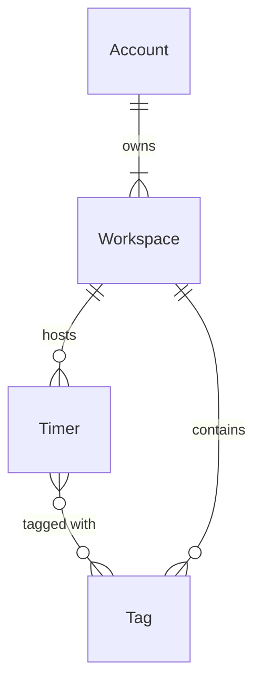

# Kairos

## Overview
* `GET /workspaces` - list all the workspaces owned by the account (i.e. user).
* `GET /workspaces/{workspaceId}/timers` - list all the timers associated with the workspace.
* `GET /workspaces/{workspaceId}/timers/{timerId}` - details of the specified timer.
* `GET /workspaces/{workspaceId}/tags` - list all the tags in the workspace.

## Model

## Questions
* Should timers start running or stopped? Or should we have different endpoints/requests?
* What kind of API do we want to filter timers by tag?
