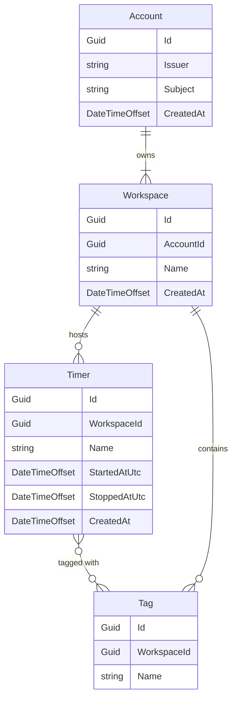

# Kairos

Kairos is a lightweight time tracking web API built with .NET 11 and ASP.NET Core Minimal APIs, utilizing Entity Framework Core with SQLite.

## Tech Stack
* **Framework:** .NET 11 (`net11.0`) / ASP.NET Core Minimal APIs
* **Database & ORM:** SQLite with Entity Framework Core (WAL journal mode enabled)
* **Identifiers:** UUIDv7 formatted as 32-character hexadecimal strings without hyphens (`N` format)

## Domain Model


## API Endpoints

### Workspaces
* `POST /workspaces` - Create a new workspace for the current account.
  * **Request Body:** `{ "name": "string" }`
  * **Response:** `201 Created` with `{ "id": "guid", "name": "string", "created_at": "datetime" }`
* `GET /workspaces` - List all workspaces owned by the account.
  * **Response:** `200 OK` with an array of workspace items.
* `GET /workspaces/{workspaceId}` - Get details for a specific workspace.
  * **Response:** `200 OK` with `{ "id": "guid", "name": "string", "created_at": "datetime" }` or `404 Not Found`.

### Timers
* `POST /workspaces/{workspaceId}/timers` - Create and immediately start a new timer in a workspace.
  * **Request Body:** `{ "name": "string" }`
  * **Response:** `201 Created` with `{ "id": "guid", "name": "string", "workspace_id": "guid", "duration": "timespan", "started_at": "datetime", "created_at": "datetime" }`
* `GET /workspaces/{workspaceId}/timers` - List all timers associated with the specified workspace.
  * **Response:** `200 OK` with an array of timers including start/stop timestamps and duration.
* `GET /workspaces/{workspaceId}/timers/{timerId}` - Get details of a specific timer.
  * **Response:** `200 OK` with timer details or `404 Not Found`.
* `POST /workspaces/{workspaceId}/timers/{timerId}/start` - Start or resume a timer (clears `stopped_at`).
  * **Response:** `200 OK` with updated timer details or `404 Not Found`.
* `POST /workspaces/{workspaceId}/timers/{timerId}/stop` - Stop an active timer (sets `stopped_at` to current UTC time).
  * **Response:** `200 OK` with updated timer details or `404 Not Found`.

### Accounts (Development / Internal)
* `POST /accounts` - Create a default development account.
* `GET /accounts` - List all existing accounts.

## Getting Started

### Prerequisites
* [.NET 11 SDK](https://dotnet.microsoft.com/)

### Running the Application
```bash
dotnet run --project src/Kairos
```
By default, the SQLite database is created locally at `kairos.db`.
